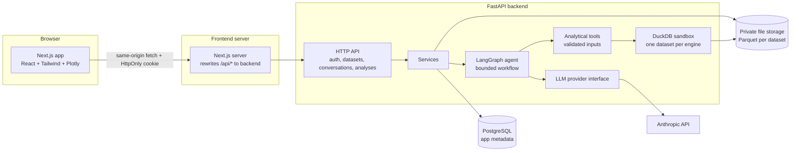
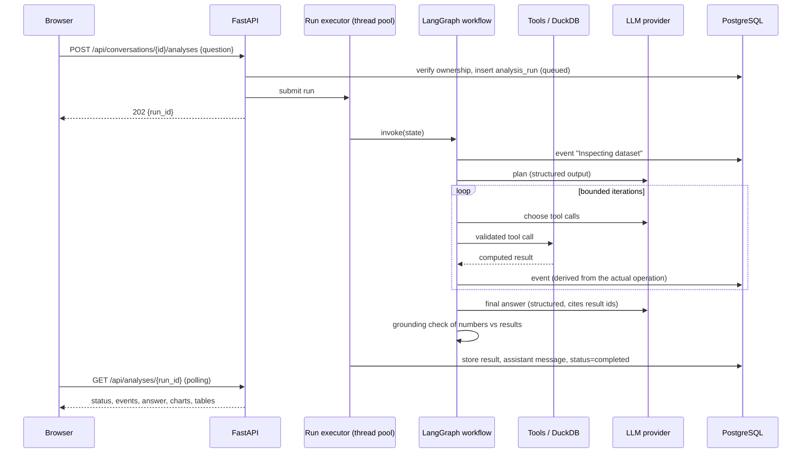
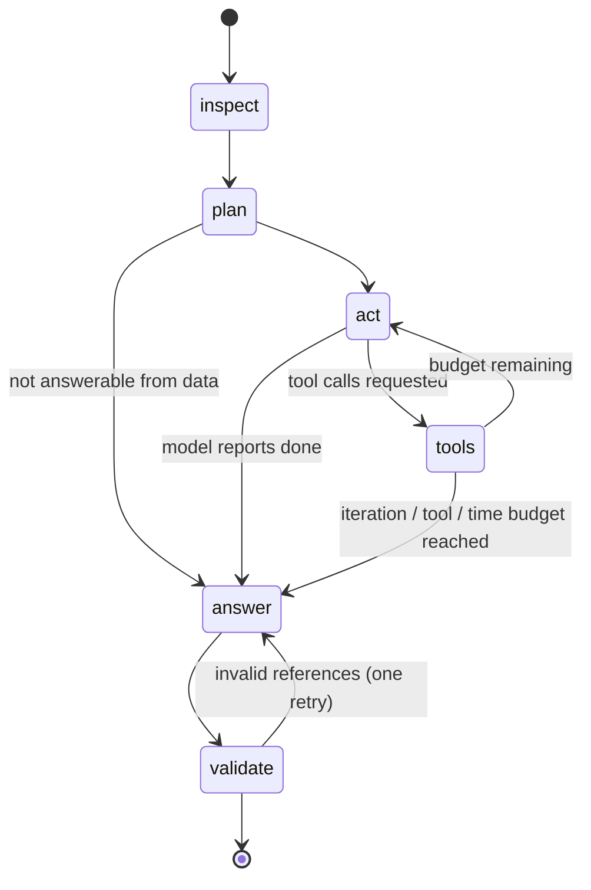

# Architecture

> Living document: it describes the design the code implements. See
> [PROJECT_PROGRESS.md](PROJECT_PROGRESS.md) for build history and
> [KNOWN_LIMITATIONS.md](KNOWN_LIMITATIONS.md) for what is not done or not verified.

## 1. System overview

Autonomous Data Analyst lets an authenticated user upload a CSV/XLSX dataset, inspect an
automatically generated profile, and ask natural-language questions. A bounded LangGraph
workflow plans the analysis, calls a small set of **validated analytical tools** that run real
computations against the user's dataset, builds chart specifications from the computed results,
and writes an answer that cites those results.



## 2. Key decisions

| Decision | Choice | Why |
|---|---|---|
| App database | PostgreSQL + SQLAlchemy 2.x + Alembic | Required stack; relational ownership model; migrations instead of `create_all`. |
| Uploaded data storage | Validated, normalized **Parquet files** in private storage, keyed by UUID; metadata + profile in PostgreSQL | Keeps analytical data separate from application tables; no large blobs in Postgres; columnar format is fast to query. |
| Analytical query engine | **DuckDB**, one in-memory engine per analysis run that contains only the authorized dataset (table `data`), with external access disabled and configuration locked | Strongest practical isolation: the engine physically cannot see application tables, other users' datasets, or the filesystem. Fast SQL over Parquet. |
| SQL safety | `sqlglot` AST validation: single read-only statement, table allowlist (`data` + CTEs), function allowlist, then the **re-generated** SQL is executed with a timeout and row cap | Checking for a leading `SELECT` is not sufficient; executing the validated AST avoids parser-differential bypasses. |
| Preferred analysis path | Typed, predefined operations (`aggregate`, `time_series`, `period_comparison`, `distribution`, `correlation`, `outliers`, `missing_values`) compiled to SQL with quoted, schema-validated identifiers and bound parameters | Deterministic, testable without an LLM, and safer than free-form SQL. `execute_sql` exists for questions the operations cannot express. |
| Arbitrary Python execution | **Not provided** | Not required by any feature; avoids the need for a hardened sandbox. Documented in KNOWN_LIMITATIONS. |
| Agent orchestration | LangGraph `StateGraph` with explicit nodes and conditional edges | Required stack; explicit state, bounded loops, testable routing. |
| LLM provider | Anthropic Claude via the official `anthropic` SDK, behind an `LLMProvider` interface; model configurable (default `claude-opus-5-5`) | One practical provider; interface allows replacement and a scripted test double. |
| Structured outputs | Pydantic models for plans and final answers; tool inputs validated by Pydantic before execution | The model's output is never trusted until it validates. |
| Background execution | Analysis runs execute in a bounded in-process thread pool; progress persisted as events; client polls | Avoids Redis/Celery for a single-node deployment. Trade-off documented: runs interrupted by a restart are marked failed. |
| Auth | Email + password (Argon2id), opaque server-side session tokens stored hashed in PostgreSQL, HttpOnly + SameSite cookie | Tokens never readable by JavaScript; sessions revocable server-side. |
| CSRF | SameSite=Lax cookie **and** a required custom request header on unsafe methods | A cross-site form cannot set custom headers; a cross-site `fetch` with one is blocked by CORS preflight. |
| Browser-to-API routing | Next.js rewrites `/api/*` to the backend | Same-origin cookies in every environment; narrow CORS. |
| Frontend data layer | TanStack Query + a typed client generated from the backend's OpenAPI schema | Consistent loading/error/retry states; API contract drift is detectable in CI. |
| Charts | Backend returns validated chart specs whose data is copied from a computed result; frontend renders with Plotly | The model chooses chart *shape*, never chart *numbers*. |

## 3. Backend modules

```
backend/app/
  main.py            app factory: middleware order, routers, runner wiring
  config.py          typed settings from environment (with production checks)
  errors.py          error envelope and handlers; middleware.py adds request ids,
                     security headers and the sanitized 500; body_limit.py caps bodies
  db/                SQLAlchemy base (naming conventions), models, session management
  auth/              Argon2id passwords, session service, CSRF middleware, rate limiter
  api/               HTTP routers (thin: validate, authorize, call services) and deps
  schemas/           Pydantic request/response models
  datasets/          ingestion (ingest.py), type inference, profiling, storage, service
  analytics/         DuckDB sandbox (engine.py) in a capped child process (isolation.py),
                     SQL guard, typed operations, chart specs
  agent/             llm/ (interface, Anthropic, fake), tools, prompts, context,
                     grounding check, LangGraph workflow (graph.py)
  services/          conversations and runs (conversations.py), background runner
backend/evals/       evaluation datasets, cases, scoring and runner
```

Rules:

- HTTP handlers do not contain business logic.
- `analytics/` has no knowledge of HTTP, the database, or the LLM; it is tested directly.
- Provider-specific SDK code lives only in `agent/llm/anthropic_provider.py`.
- Every query for user-owned data filters by the authenticated user's id. Non-owned resources
  return `404`, so existence is not leaked.

## 4. Data flow: asking a question



## 5. Agent workflow



Bounds (configurable): maximum act iterations, maximum tool calls per run, per-LLM-call timeout,
per-query timeout, and a wall-clock deadline for the whole run. Cancellation is checked between
nodes. Activity events are generated from the **validated tool inputs** that actually executed,
not from model free text, and no model reasoning is shown.

Context passed to the model is bounded: column metadata, profile summaries, small previews,
truncated tool results, and a short summary of earlier turns in the same conversation. Full
datasets are never sent.

## 6. Analytical sandbox

Per analysis run, in a child process started for that run (`analytics/isolation.py`):

0. The child removes secret-looking environment variables it inherited and, on Linux, caps its
   own address space (`ANALYTICS_PROCESS_MEMORY_BYTES`, default 2 GiB; it needs about 1.3 GB
   before its first query). Then:
1. `duckdb.connect(":memory:")` with thread and memory limits and extension autoload disabled.
2. `CREATE TABLE data AS SELECT * FROM read_parquet(<this dataset's file>)`.
3. `SET enable_external_access = false; SET lock_configuration = true;`
4. Every query: validated by the SQL guard, executed with an interrupt-based timeout, results
   fetched with a row cap, values converted to JSON-safe types.

Defence in depth: even if the validator missed something, the engine has no filesystem/network
access, no other tables, and cannot change its own configuration. Allocations that DuckDB's own
`memory_limit` does not govern (large string results) hit the process cap and fail inside the
child; a query that outlives its timeout by 5 seconds gets the child killed; a dead child is
restarted for the next query. The API process never runs model-driven SQL itself.

## 7. Data model

See [DATA_MODEL.md](DATA_MODEL.md). Entities: users, sessions, datasets, conversations,
analysis_runs (one per question; the conversation turn), analysis_events.

## 8. Deployment topology

See [DEPLOYMENT.md](DEPLOYMENT.md). Frontend, backend and PostgreSQL containers with persistent
volumes; in production a Caddy edge terminates TLS and sets `X-Forwarded-For` (Next.js rewrites
do not), and only the edge is published.

## 9. Request path and middleware order

Browser → (Caddy) → Next.js (`src/proxy.ts` rejects oversized uploads with a 413 before Next.js
buffers them, then the `/api` rewrite) → FastAPI middleware, outermost first:

1. **RequestContext**: request id, security headers, sanitized 500 for unexpected errors.
2. **CORS**: only configured origins, credentials allowed.
3. **CSRF**: unsafe methods need `X-Requested-With: fetch`, a configured `Origin` if one is
   sent, and no cross-site Fetch Metadata.
4. **Body size limit**: declared and streamed size checked (upload route: file limit plus
   multipart overhead; everything else: 1 MB).
5. Routes: authentication dependency, rate limits, validation, services.
