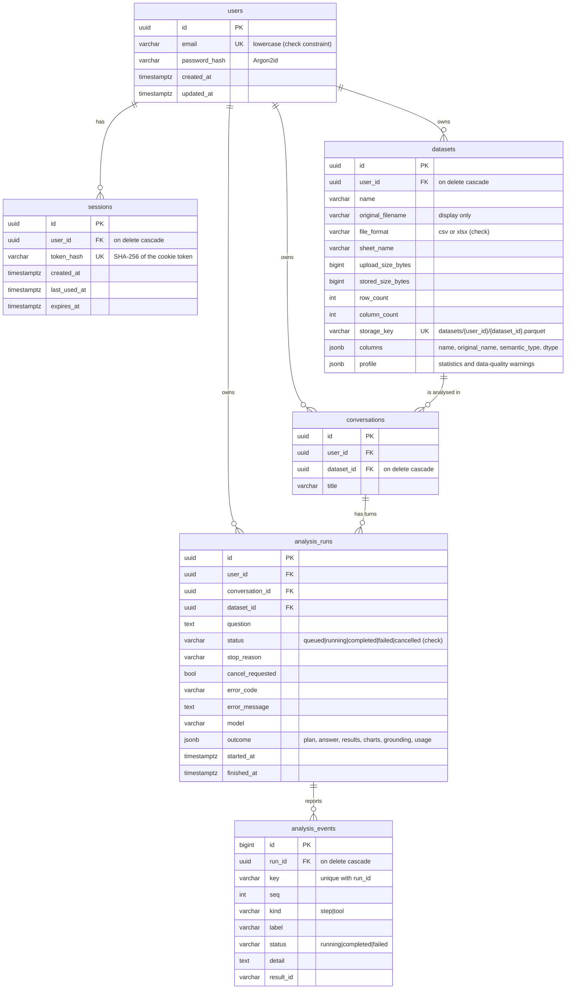

# Data model

Application metadata lives in **PostgreSQL**; uploaded data lives in **private file storage**
as one Parquet file per dataset. The analytical engine (DuckDB) only ever sees one dataset file
at a time and never connects to PostgreSQL.

The schema is created and changed only by Alembic migrations in
[`backend/migrations/versions`](../backend/migrations/versions): `0001` users and sessions,
`0002` datasets, `0003` conversations, analysis runs and events, `0004` at most one active
run per conversation (see below). Tests migrate an empty database
from scratch, round-trip downgrade/upgrade, and fail if the models and migrations disagree.

## Design decisions

- **No separate `messages` table.** Each conversation turn is exactly one analysis run (the
  question and everything the agent produced for it). A messages table would duplicate that and
  could drift from it.
- **Outcome as JSONB.** A run's plan, answer, result tables, chart specs and grounding report
  are written once, read together, and never queried by field, so a document column fits. Result
  tables are bounded by the engine's row cap.
- **Events as rows.** Activity events are written while a run progresses and polled by the UI;
  they are upserted by `(run_id, key)` so a step moves from `running` to `completed`.
- **One active run per conversation, enforced by the database.** A partial unique index on
  `analysis_runs (conversation_id) WHERE status IN ('queued', 'running')` decides when two
  requests start a run at the same moment; the loser gets `409 analysis_in_progress`. The
  migration first fails any duplicates left from before, as restart recovery would.
- **Ownership on every row.** `user_id` is stored on datasets, conversations and runs (not only
  derivable through joins) so every query filters by owner directly.
- **Cascades.** Deleting a user removes everything they own; deleting a dataset removes its file,
  conversations and runs; deleting a conversation removes its runs and events.
- **Indexes** follow the access paths: `(user_id, created_at)` for listings and history,
  `(conversation_id, created_at)` for threads, `(run_id, seq)` for event polling,
  `status` for restart recovery, and `token_hash` (unique) for session lookup.
- **Timestamps** are timezone-aware (`timestamptz`) and set in UTC.

## Dataset files

`storage_dir/datasets/{user_id}/{dataset_id}.parquet`, zstd-compressed, row groups of 50,000.
Keys are built only from UUIDs, validated against a strict pattern, and resolved paths must stay
inside the storage root. Files are written to a temporary name and atomically renamed. Deleting a
dataset removes the database row first, so a failure can leave an orphaned file but never a row
that points at missing data.
