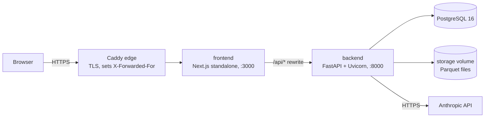

# Deployment

> **Status: not deployed.** The images, Compose files and the smoke test below are verified in
> CI (the `docker` job builds both images, starts the stack and exercises it), but no public
> deployment has been made, because that needs a server/account and a domain. Nothing here
> claims otherwise.

## Architecture in production



Only the edge publishes ports (80/443). The frontend, backend and database are reachable only on
the private Compose network. The backend trusts `X-Forwarded-For` because nothing but the
frontend can reach it, and Caddy replaces any client-supplied value with the real address.

| Container | Image | Runs as | Health check |
|---|---|---|---|
| edge | `caddy:2-alpine` | Caddy default | n/a |
| frontend | built from `frontend/Dockerfile` (Node 24, standalone) | `node` (uid 1000) | `GET /login` |
| backend | built from `backend/Dockerfile` (Python 3.12, uv) | `app` (uid 10001) | `GET /api/health` |
| db | `postgres:16-alpine` | postgres | `pg_isready` |

The backend applies migrations (`alembic upgrade head`) on start and runs **one** Uvicorn worker
per container; see [KNOWN_LIMITATIONS.md](KNOWN_LIMITATIONS.md) for why and how to scale.

## Recommended low-cost path: one small VM

The stack needs persistent disk (PostgreSQL and uploaded datasets) and long-running background
work, which suits a single VM better than serverless platforms.

1. **Server.** A VM with 2 vCPU / 4 GB RAM and Docker Engine with the Compose plugin
   (Compose ≥ 2.24). Examples, all **paid**: Hetzner CX22 (about €4–5/month), DigitalOcean
   or Linode 4 GB (about $24/month), AWS Lightsail 4 GB (about $24/month). Prices change;
   check before buying.
2. **DNS.** Point an `A` record (e.g. `analyst.example.com`) at the server. Open ports 80 and
   443 only.
3. **Configure.**
   ```bash
   git clone https://github.com/param7862989-ops/autonomous-data-analyst.git
   cd autonomous-data-analyst
   cp .env.example .env
   # edit .env:
   #   DOMAIN=analyst.example.com
   #   PUBLIC_ORIGIN=https://analyst.example.com
   #   POSTGRES_PASSWORD=<long random value>
   #   ANTHROPIC_API_KEY=<your key>          # paid per use; see "Costs" below
   #   ALLOW_REGISTRATION=true|false
   chmod 600 .env
   ```
4. **Start.**
   ```bash
   docker compose -f docker-compose.yml -f deploy/docker-compose.prod.yml up --build -d
   docker compose -f docker-compose.yml -f deploy/docker-compose.prod.yml ps
   ```
   The overlay forces `ENVIRONMENT=production` (secure cookies, API docs off) and adds Caddy,
   which obtains a certificate on first start.
5. **Smoke test** from your machine (creates a throwaway account and uploads the sample):
   ```bash
   ./scripts/smoke_test.sh https://analyst.example.com
   ```
6. **Close registration** after creating your accounts, if the deployment is personal:
   set `ALLOW_REGISTRATION=false` and re-run step 4.

### Operations

- **Backups.** `docker compose exec db pg_dump -U ada ada > backup.sql` for metadata, plus the
  `storage` volume (dataset files). Both are needed to restore.
- **Upgrades.** `git pull` then step 4; migrations run on backend start. Take a backup first.
- **Logs.** `docker compose logs -f backend`. Logs carry request ids, never request bodies,
  passwords, tokens or dataset contents.
- **Secrets.** Only in `.env` on the server (not in images, Compose files or Git). Rotate the
  Anthropic key in its console and restart the backend.

## Alternatives

| Option | Fit | Notes |
|---|---|---|
| Single VM + Compose (above) | Best | Cheapest predictable cost; you manage OS updates and backups |
| Render / Railway / Fly.io | Workable | Run the two images as services plus managed PostgreSQL; the backend needs a **persistent volume** for `/data/storage` (a paid add-on on these platforms) and must stay a single instance |
| Vercel (frontend) + VM (backend) | Not recommended | Next.js rewrites would cross sites; the frontend must be built with the backend's public URL, and per-IP rate limits would see Vercel's addresses |

## Costs that can be incurred

- **Server and storage**: billed by the hosting provider.
- **Anthropic API**: billed per token. Each question makes roughly 3–8 model calls; with
  `claude-opus-5-5` at medium effort a typical question costs a few cents. Limit exposure with
  `ANALYSES_PER_USER_PER_HOUR`, `AGENT_MAX_ITERATIONS`, `AGENT_MAX_TOOL_CALLS`, a cheaper
  `LLM_MODEL`, `LLM_EFFORT=low`, and a spend limit in the Anthropic console.
- **Domain**: from your registrar.

## What CI verifies

The `docker` job in [.github/workflows/ci.yml](../.github/workflows/ci.yml) on every push:
builds both images, starts PostgreSQL, backend and frontend with health checks, then through the
frontend: loads the sign-in page, checks readiness, registers, uploads the sample dataset
(7,620 rows), confirms analysis reports as disabled without a key, and checks both application
containers run as non-root.
