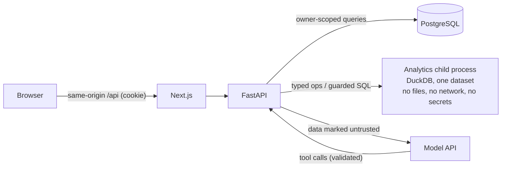

# Security

This document describes what the application protects, from whom, how, and which tests prove
each control. Residual risks are listed in [KNOWN_LIMITATIONS.md](KNOWN_LIMITATIONS.md).

## 1. What is protected

| Asset | Why it matters |
|---|---|
| Uploaded datasets (Parquet files) and their profiles | May contain business or personal data; private to the uploader |
| Conversations, questions, answers, computed results | Reveal the content of the data |
| Accounts and sessions | Access to everything above |
| The server (CPU, memory, disk) and the model budget | Uploads and analyses are expensive; abuse costs money or availability |
| Secrets (`ANTHROPIC_API_KEY`, database password) | Must never reach the browser, the model, logs or the analytics engine |

## 2. Threat model

| Actor or input | Can do | Main risks |
|---|---|---|
| Anonymous internet user | Reach the login, registration and health endpoints | Credential stuffing, account enumeration, resource exhaustion, CSRF against signed-in users |
| Signed-in user | Upload files, ask questions, read their own records | Reading or changing another user's data; exhausting server memory or the model budget |
| Uploaded file content | Anything a CSV or XLSX can encode | Parser exploits (zip bombs, XML entities, macros), formula injection, oversized shapes, markup in labels |
| Dataset values seen by the model | Text the model reads as data | Prompt injection: steering the model's wording or its tool calls |
| The model's output | Tool calls, SQL, chart requests, answer text | Escaping the sandbox, reading other data, amplifying resource use, inventing numbers |
| Dependencies and CI | Code that runs in build or at runtime | Known-vulnerable packages, tampered actions |

The model is treated as **untrusted**: everything it produces is validated before anything runs,
and its tools can reach only the current user's current dataset, read-only.

## 3. Controls and their tests

### Authentication and sessions

| Control | Tests |
|---|---|
| Argon2id password hashes; session tokens stored only as SHA-256 hashes | `test_auth.py::test_passwords_and_tokens_are_stored_hashed` |
| HttpOnly, SameSite=Lax cookie; `Secure` in production (startup fails otherwise) | `test_register_sets_secure_session_cookie`, `test_production_cookies_are_secure`, `test_config.py` |
| Absolute (7 days) and idle (24 hours) expiry; expired sessions deleted | `test_expired_session_is_rejected_and_deleted`, `test_idle_session_is_rejected`, `test_activity_extends_idle_window` |
| Session rotated at login, revoked server-side at logout; forged tokens rejected | `test_login_rotates_existing_session`, `test_logout_revokes_session_server_side`, `test_forged_token_is_rejected` |
| One message for unknown email and wrong password (no account enumeration) | `test_login_success_and_failures_share_a_message` |
| Login limited per IP (20/min) and failed logins per account (10 per 15 min); registration per IP | `test_login_rate_limited_per_ip`, `test_login_failures_rate_limited_per_account`, `test_rate_limit.py` |
| Registration can be switched off for private deployments | `test_registration_can_be_disabled` |

### Authorization and data isolation

| Control | Tests |
|---|---|
| Every query filters by the signed-in user; another user's records return `404` exactly like missing ones | `test_datasets_api.py::test_users_cannot_see_each_others_datasets`, `test_analyses_api.py::test_users_cannot_reach_each_others_conversations_or_analyses`, E2E "isolation between users" |
| Follow-up context comes only from the same conversation | `test_follow_up_uses_earlier_turns_of_the_same_conversation_only` |
| Storage keys derive from server-generated IDs; user filenames are display-only | `test_storage.py::test_key_is_derived_from_ids_only`, `test_invalid_keys_are_rejected`, `test_filename_is_display_only` |
| Deleting a user or conversation cascades | `test_deleting_user_cascades_to_datasets`, `test_rename_and_delete_cascade` |
| One active analysis per conversation, enforced by a partial unique index | `test_one_active_analysis_per_conversation`, `test_simultaneous_requests_cannot_start_two_analyses` |

### Browser-facing protections

| Control | Tests |
|---|---|
| CSRF: state-changing requests need `X-Requested-With: fetch`, an allowed `Origin`, and no cross-site `Sec-Fetch-Site` | `test_csrf.py` (5 tests) |
| CORS limited to configured origins; wildcard origins rejected in production | `test_cors_allows_configured_origin_only`, `test_wildcard_origin_rejected_in_production` |
| Security headers on API and pages (CSP, `nosniff`, `X-Frame-Options: DENY`, referrer and permissions policies); HSTS at the TLS edge | API: `test_security_headers_present`; pages: E2E "pages send security headers" |
| React escaping everywhere; no `dangerouslySetInnerHTML` | Code review (no occurrences in `frontend/src`) |
| Chart labels from data are escaped so Plotly cannot render them as links or markup | `plotly.test.ts` ("escapes text from the data…"), checked in Chromium |

### Uploads

| Control | Tests |
|---|---|
| Type detected from content (magic bytes), not the extension | `test_detect_csv_and_xlsx`, `test_detect_rejects_wrong_types`, `test_csv_binary_content_rejected` |
| Request body cut off at 25 MB before parsing; JSON bodies capped at 1 MB | `test_oversized_body_is_cut_off_before_parsing`, `test_file_over_upload_limit_is_rejected`, `test_json_body_limit` |
| Shape limits (500,000 rows, 200 columns, 10 million cells), checked before full parsing | `test_csv_row_limit`, `test_csv_column_and_cell_limits`, `test_csv_very_wide_header_is_rejected_before_parsing`, `test_xlsx_row_limit`, `test_xlsx_phantom_rows_are_bounded` |
| XLSX: zip-bomb check on uncompressed size, `defusedxml`, macro-enabled and encrypted workbooks rejected, formulas never evaluated | `test_xlsx_zip_bomb_rejected_before_parsing`, `test_xlsx_macro_enabled_content_rejected`, `test_xlsx_formulas_are_never_evaluated`, `test_zip_that_is_not_a_workbook` |
| Formula-looking text kept as inert text | `test_csv_formula_text_is_kept_as_text` |
| Per-user dataset quota and upload rate limit; bounded concurrent parsing | `test_dataset_quota`, `test_upload_rate_limit` |

### Analysis sandbox

Model-driven analysis passes through four independent layers. Any one of them failing open still
leaves the others.

1. **Typed operations and validated tool input.** Tools accept strict schemas; identifiers are
   checked against the dataset's columns and quoted; values are bound parameters.
   (`test_operations.py::test_filter_values_are_bound_not_interpolated`,
   `test_schema_rejects_malformed_operations`, `test_agent.py::test_invalid_tool_input_is_returned_to_the_model`)
2. **SQL guard for the free-form SQL tool.** One `SELECT` statement only; an allowlist over the
   parsed syntax tree (node types and functions); every table reference must resolve, scope by
   scope, to `data` or a CTE visible in that scope; string-amplifying functions are not allowed
   and concatenation is capped; the regenerated SQL is what runs.
   (`test_sql_guard.py`: allowed and rejected cases, `test_cte_names_do_not_open_other_tables`)
3. **Sandboxed DuckDB.** A fresh in-memory database per run containing only that dataset;
   external access disabled and configuration locked before any model query; thread and memory
   limits; an interrupt-based timeout; a row cap; long text values clipped; file paths removed
   from error messages.
   (`test_engine.py::test_sandbox_blocks_escapes_even_without_the_guard`,
   `test_only_the_dataset_is_visible`, `test_timeout_interrupts_long_queries`,
   `test_errors_are_sanitized`)
4. **A separate, capped process.** The engine runs in a child process that removes secret-looking
   environment variables before loading anything. On Linux its address space is capped
   (`ANALYTICS_PROCESS_MEMORY_BYTES`, default 2 GiB; the child needs about 1.3 GB before its first
   query). A query that does not return within its timeout plus 5 seconds gets the child killed
   and restarted, and a crashed child is restarted for the next query.
   (`test_isolation.py`; the memory-cap test runs on Linux, including CI)

Around the loop: iteration, tool-call (per turn and total) and wall-clock limits, cancellation
checks, per-user analysis rate limits, and a grounding check that flags figures in the answer
that no computed result supports (`test_agent.py`, `test_grounding.py`).

No model-written Python or other code is ever executed.

### Prompt injection

Dataset values, column names and earlier answers reach the model inside clearly marked data
sections, with an instruction to treat them as untrusted
(`test_prompt_marks_dataset_values_as_untrusted`). This reduces, but cannot eliminate, the
chance that a crafted value changes the model's wording. It cannot widen access: every tool
call is validated as above and can only read the current user's dataset.

### Errors, logging and secrets

| Control | Tests |
|---|---|
| Unhandled errors return a generic envelope with a request ID; no stack traces or input echoed | `test_errors.py` (6 tests) |
| Engine messages shown to the model have filesystem paths removed | `test_sanitize_engine_message_removes_paths` |
| Secrets are `SecretStr` settings from the environment; `.env` is git-ignored; the analytics child scrubs them | `test_secrets_are_scrubbed_from_the_child_environment` |
| API docs can be disabled (they are in the production overlay) | `test_api_docs_can_be_disabled` |

### Infrastructure and supply chain

- Containers run as non-root users (backend uid 10001, frontend uid 1000); only the edge (or,
  without it, the frontend) publishes a port.
- In the production overlay Caddy terminates TLS, sets HSTS, and replaces any client-supplied
  `X-Forwarded-For`; only there does the backend trust that header.
- CI actions are pinned to commit SHAs; Dependabot proposes grouped updates.
- CI audits runtime dependencies: `pip-audit` on the locked Python runtime set and
  `npm audit --omit=dev --audit-level=high`.

## 4. Security review findings (Day 17)

An independent review of the code (an AI agent instructed to look for authorization bypasses,
injection and resource exhaustion) found **no authorization bypass**. It reported seven issues,
all now fixed:

| # | Finding | Impact | Fix | Verified by |
|---|---|---|---|---|
| 1 | A CSV with a very wide header was fully parsed by pandas before the column limit applied | Memory exhaustion during upload | Header fields are counted with the `csv` module first | `test_csv_very_wide_header_is_rejected_before_parsing` |
| 2 | An XLSX could declare millions of empty "phantom" rows | Slow scan: a crafted file took 13 s and was accepted | Row scan bounded by the row limit plus an allowance for empty rows; rejected in 0.15 s | `test_xlsx_phantom_rows_are_bounded` |
| 3 | String-amplifying SQL (`REPEAT`, `LPAD`, nested `REPLACE`, long concatenations) allocates outside DuckDB's `memory_limit` | Memory exhaustion of the API process | Functions removed from the allowlist, concatenation capped, text clipped, and the engine moved to a capped child process | `test_sql_guard.py` rejected cases, `test_isolation.py::test_memory_cap_stops_string_amplification` |
| 4 | The guard treated any CTE name as safe in every scope, so `FROM (WITH duckdb_tables AS (…) …) t, duckdb_tables` reached a catalog table | Read DuckDB metadata (the sandbox still held only the one dataset) | Scope-aware resolution of every table reference; unresolved references fail closed | `test_sql_guard.py` "cte scope smuggling" cases |
| 5 | The base Compose file trusted `X-Forwarded-For` from anyone, and the published frontend passes it through | A client could choose its own key for per-IP rate limits | Header trusted only in the production overlay, behind Caddy | Configuration review (`docker-compose.yml`, `deploy/docker-compose.prod.yml`) |
| 6 | Plotly renders `<a href>` and other markup found in chart labels | A dataset could plant a phishing link in a chart | Data-derived chart text is entity-escaped | `plotly.test.ts`, Chromium render check (planted links 2 → 0) |
| 7 | Two simultaneous requests could both pass the "one active analysis" check | Two concurrent runs in one conversation (double model spend) | Partial unique index (migration 0004); violation mapped to `409 analysis_in_progress` | `test_simultaneous_requests_cannot_start_two_analyses`, `test_one_active_run_migration_resolves_existing_duplicates` |

## 5. Accepted risks

See [KNOWN_LIMITATIONS.md](KNOWN_LIMITATIONS.md#security-and-accounts). In brief: the CSP
allows inline scripts (Next.js without nonces); accounts have no email verification, reset or
MFA; rate limits are in-process (one worker); the address-space cap applies on Linux only; one
dev-only advisory remains in the lint toolchain; there is no audit log.

## 6. Reporting a vulnerability

Please report suspected vulnerabilities privately to the repository owner
([param7862989-ops](https://github.com/param7862989-ops)) rather than in a public issue.
